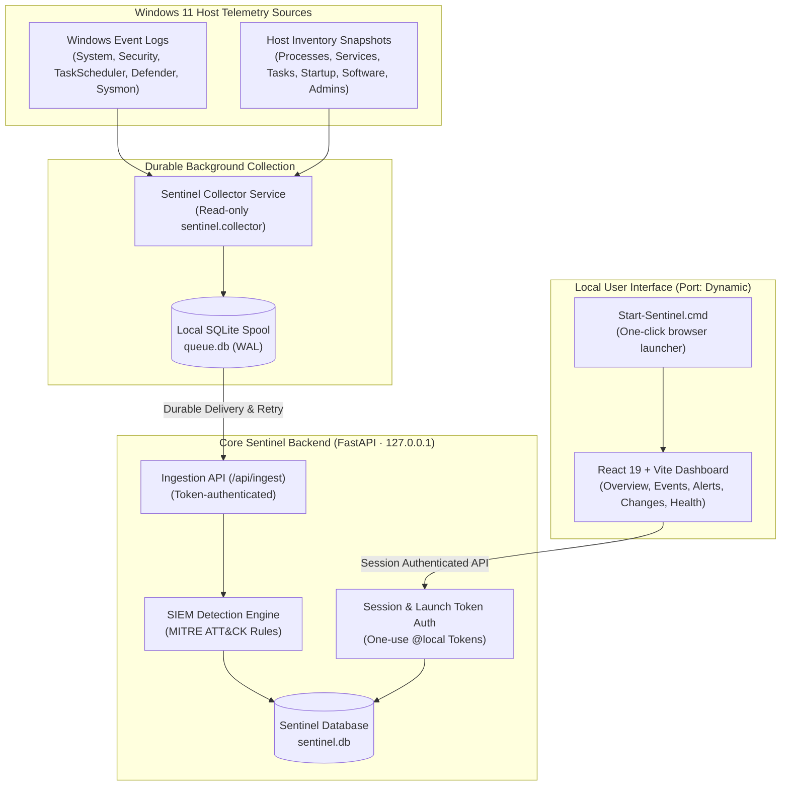

# Project Sentinel — Personal Host SIEM & Security Monitoring

[](https://github.com/mohalima1/project-sentinel/actions/workflows/ci.yml)
[](https://www.python.org/)
[](https://fastapi.tiangolo.com/)
[](https://react.dev/)
[](https://www.typescriptlang.org/)
[](https://vitejs.dev/)
[](https://sqlite.org/)
[](https://microsoft.com/windows)
[](https://attack.mitre.org/)
[](LICENSE)
[-success.svg)]()

**Project Sentinel** is a local, privacy-first personal Security Information and Event Management (SIEM) and host security monitoring system built for Windows 11 x64. It collects live host telemetry, detects suspicious activity with evidence-backed rules mapped to MITRE ATT&CK, buffers events through a crash-resilient local spool, and surfaces security insights through an authenticated React dashboard.

No AI model, external cloud account, paid subscription, or outbound telemetry upload is required.

---

## Table of Contents

- [Key Features](#key-features)
- [Architecture](#architecture)
- [Project Structure](#project-structure)
- [Quick Start (Windows 11)](#quick-start-windows-11)
- [Manual Development Setup](#manual-development-setup)
- [Data & Schema Upgrades](#data--schema-upgrades)
- [Packaging & Windows Service Build](#packaging--windows-service-build)
- [Verification Suite](#verification-suite)
- [Architecture & Security Documentation](#architecture--security-documentation)
- [License](#license)

---

## Key Features

- 🛡️ **Real Windows Host Monitoring**:
  - Live collection of Windows Event Logs (`System`, `Security`, `Microsoft-Windows-TaskScheduler/Operational`, `Microsoft-Windows-Windows Defender/Operational`, `Sysmon`).
  - Periodic diff snapshots of running processes, Windows services, scheduled tasks, startup commands, local administrator group members, and installed software.
  - Transparent reporting of permission denials (e.g. non-elevated Security log access) and disabled sources.
- 💾 **Durable Local Collection & Spooling**:
  - Decoupled background collector process (`sentinel.collector`) with a crash-resilient SQLite spool (`queue.db`).
  - Bounded buffering, cursor tracking, and backpressure safeguards.
  - Safe replay and deduplication: restarts never lose queued logs or create duplicate events.
- 🔍 **Evidence-Backed SIEM Detection Rules**:
  - Six core Windows detection rule families: Repeated failed logins (4625), Local administrator group changes (4732/4733), New service installation (4697/7045), Scheduled task creation (4698/4702), Security log clearing (1102), and Defender threat detections (1116).
  - Explicit MITRE ATT&CK technique mapping, official Microsoft prerequisites, and actionable investigation guidance.
  - Alert deduplication, threshold grouping, suppression, and triage workflows (`new`, `investigating`, `resolved`, `false_positive`).
- 🖥️ **Authenticated Local Web Dashboard**:
  - Responsive React 19 + TypeScript + Vite UI with dark-mode aesthetic.
  - Six main views: **Overview**, **Changes**, **Events**, **Alerts**, **Collection Health**, and **Settings & Audit**.
  - Seamless launch via `Start-Sentinel.cmd` using short-lived one-use local tokens (`@local`), with optional password accounts for development.
- 📦 **Reproducible Packaging & Native Windows Service**:
  - Pinned standalone Python 3.12.13 runtime with strict SHA-256 dependency lock (`requirements.lock`).
  - Native 64-bit Windows Service host (`SentinelService.exe`).
  - Scripted installer (`installer/install.ps1`) and uninstaller (`installer/uninstall.ps1`) with strict Windows ACLs and automatic pre-upgrade database backups.

---

## Architecture



---

## Project Structure

```text
project-sentinel/
├── agent/                     # Background agent boundaries and architecture notes
├── backend/
│   └── sentinel/
│       ├── collector/         # Windows telemetry collector, spool, and event readers
│       ├── monitoring/        # Detection rules, evidence models, ingestion, credentials
│       ├── accounts.py        # Authentication, password hashing, and session management
│       ├── app.py             # FastAPI web application and protected REST API
│       ├── config.py          # Application configuration and file system paths
│       ├── db.py              # SQLite engine configuration (WAL mode, timeouts)
│       └── models.py          # SQLAlchemy persistence models (Audit, Sessions, Users)
├── frontend/
│   ├── src/                   # React 19 + TypeScript components, styles, and dashboard tabs
│   ├── package.json           # Frontend dependencies (React 19, TypeScript, Vite)
│   └── vite.config.ts         # Vite build configuration and local API proxy
├── installer/
│   ├── SentinelService.cs     # Native Windows service host implementation
│   ├── build.ps1              # Reproducible package builder and dependency verification
│   ├── install.ps1            # Elevated Windows installer with permission locking
│   └── uninstall.ps1          # Uninstaller supporting data retention or purge
├── migrations/                # Alembic database migration revisions
├── rules/                     # Detection rule definitions and MITRE references
├── scripts/
│   ├── setup.cmd              # Command wrapper for development environment setup
│   └── setup.ps1              # Automated dependency sync, build, and database setup
├── tests/                     # 63 automated unit, integration, and browser smoke checks
├── pyproject.toml             # Python package configuration and tool settings
├── uv.lock                    # Cryptographic Python dependency lockfile
└── Start-Sentinel.cmd         # One-click desktop launcher
```

---

## Quick Start (Windows 11)

### Prerequisites
- **Windows 11 x64**
- [uv](https://github.com/astral-sh/uv) (Python package and virtual environment manager)
- **Node.js 22.12+** (tested with Node 24 and npm 11)

### Launching the Dashboard

**Double-click `Start-Sentinel.cmd` in the project root.**

1. It automatically verifies dependencies, sets up the database, and builds the frontend dashboard if needed.
2. It launches the Sentinel backend on a free loopback port on `127.0.0.1`.
3. It opens your default browser directly into Sentinel using an ephemeral, one-use local authentication token.
4. Keep the command prompt window open while using Sentinel. Press **Ctrl+C** to stop the server.

> [!NOTE]
> Sessions expire automatically after 8 hours. The launcher binds exclusively to `127.0.0.1` and bare dashboard URLs reject unauthenticated access.

---

## Manual Development Setup

If you prefer to run commands manually in PowerShell:

```powershell
# 1. Complete environment setup and build
.\scripts\setup.cmd

# 2. Launch the application
.\Start-Sentinel.cmd
```

Or individual commands:

```powershell
uv sync --locked --python 3.12
npm.cmd --prefix frontend ci
npm.cmd --prefix frontend run build
uv run alembic upgrade head
```

### Development with Hot Reload

To work on frontend code with instant Vite hot-module reloading:

```powershell
# Terminal 1: Backend
uv run python -m sentinel.cli create-user admin
uv run uvicorn sentinel.app:app --host 127.0.0.1 --port 8000 --reload

# Terminal 2: Frontend dev server
npm.cmd --prefix frontend run dev
```

Open **http://127.0.0.1:5173** in your browser. Vite proxies API requests to `http://127.0.0.1:8000`.

---

## Data & Schema Upgrades

- Default database location: `data/sentinel.db`.
- To specify a custom database location, set:
  ```powershell
  $env:SENTINEL_DATABASE_PATH = 'C:\private\Sentinel\sentinel.db'
  ```
- Run schema migrations:
  ```powershell
  uv run alembic upgrade head
  ```
- Verify migration status:
  ```powershell
  uv run alembic current
  uv run alembic check
  ```

---

## Packaging & Windows Service Build

To build the standalone, reproducible Windows x64 package:

```powershell
powershell.exe -NoProfile -ExecutionPolicy Bypass -File installer/build.ps1
```

This compiles `SentinelService.exe`, bundles the standalone runtime and frontend assets, hashes all files into `manifest.json`, and outputs `artifacts\packages\Sentinel-<timestamp>.zip`.

To install on a Windows system (from an elevated PowerShell inside the extracted zip directory):

```powershell
.\install.ps1
```

To uninstall:

```powershell
.\uninstall.ps1 -Data Retain    # Keeps database and collector logs
# OR
.\uninstall.ps1 -Data Remove    # Cleans up all data and binaries
```

---

## Verification Suite

Run the full automated verification test suite:

```powershell
# 1. Full Python unit and integration regression suite (63 tests)
uv run pytest -q

# 2. Ruff linter and formatting checks
uv run ruff check backend migrations tests
uv run ruff format --check backend migrations tests

# 3. TypeScript and Vite frontend production build
npm.cmd --prefix frontend run build

# 4. Concurrent login transaction check
uv run python tests/concurrent_login_check.py

# 5. Browser smoke tests (Chromium headless desktop & mobile)
uv run python tests/browser_smoke.py
uv run python tests/local_browser_smoke.py

# 6. Live Windows collection, durable spooling & Chromium acceptance
uv run python tests/live_windows_acceptance.py --inventory-change
```

---

## Architecture & Security Documentation

Detailed technical documentation is available in the [`docs/`](docs/) directory:

- [Architecture & Data Flow](docs/architecture.md)
- [Security Model & Threat Boundaries](docs/security-model.md)
- [Coverage and Scope](docs/coverage.md)
- [Dependency Compatibility & Locks](docs/dependencies.md)
- [Readiness Review](docs/READINESS_REVIEW.md)
- [Installer & Windows Service Tooling](installer/README.md)
- [Collector & Agent Boundary](agent/README.md)

---

## License

This project is licensed under the MIT License — see the [LICENSE](LICENSE) file for details.
