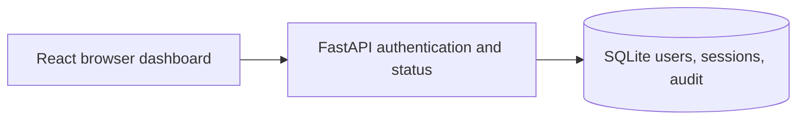
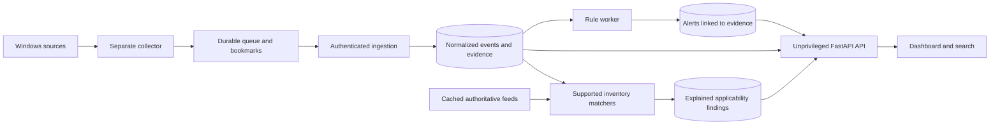

# Core concept, architecture, and readiness review

Update 2026-10-22 after local-use fixes: the R2 concurrent-login reproduction now
passes 4/4, and HTTP concurrency coverage is in pytest. R3 now uses versioned
scrypt parameters and upgrades old hashes on successful login. Local launcher
access no longer requires registration/password entry. The findings below record
the original assessment; R1 and the collector/installer gates still apply.

Reviewed 2026-10-22 against AGENTS.md and PROJECT_SPEC.md. Scope: current backend,
database/migration, frontend, setup, tests, and intended single-host Windows SIEM.
Security paths were inspected statically. Separate functional readiness checks
used temporary SQLite databases and synthetic accounts. This is not a penetration
test, exhaustive security certification, or evidence of host detection coverage.

## Original verdict (see fix status above)

**Usable for basic local development of milestone 1. Not ready as a working SIEM
or a dependable monitoring/protection application.** Even the current login flow
has a reproduced concurrency defect that should be fixed before adding ingestion.

The concept is coherent: observe this computer, retain evidence, detect defined
patterns, explain findings, and support investigation. The stack can be retained.
A framework rewrite is not needed. The missing work is the core data path and
its reliability/security contracts, rather than more dashboard decoration.

## Current implementation versus product requirements

| Capability | Current evidence | Readiness |
|---|---|---|
| Account setup, sessions, authenticated API | `backend/sentinel/accounts.py`, `app.py`, functional tests | Basic development works; concurrent login defect below |
| React dashboard and local account audit | `frontend/src/Dashboard.tsx`, `/api/audit` | Implemented; audit activity is not Windows host telemetry |
| Persisted state and migrations | Four tables in `models.py`; migration `0001` | Foundation only; no host/event/alert/finding schema |
| Host inventory and Windows event collection | `agent/` contains a README only | Missing |
| Durable queue, persisted source bookmarks, ingestion authentication | No implementation or schema | Missing |
| Searchable normalized events and retention budget | No implementation or schema | Missing |
| Evidence-backed alerts and rule evaluation | `rules/` contains a README only | Missing |
| Knowledge feeds and vulnerability applicability | No implementation or schema | Missing |
| Allowlisted privileged controls | No implementation; UI explicitly says disabled | Appropriately deferred |
| Installable Windows service/package lifecycle | `installer/` contains a README only | Deferred per user; development launch only |

The code makes this limitation explicit: `app.py:203` returns unavailable telemetry,
and the overview displays that no host assessment exists. A healthy API/database
does not establish security monitoring. Passing authentication tests does not
validate the SIEM concept end to end.

## Findings, in priority order

### R1 — High product-readiness blocker: the SIEM data path does not exist

Evidence: `backend/sentinel/models.py:8` starts the first of four authentication
and audit models; `app.py:187` exposes application status, not host events;
`agent/README.md` and `rules/README.md` describe future work. There is no event
ingestion/search or alert route to trace.

Impact: Sentinel currently cannot show what happened on the host, detect a
suspicious Windows activity, or identify applicable vulnerabilities. This is
expected staged scope, not an undisclosed claim that a finished detector works.

Next: complete milestone 2 as an actual collector-to-search flow, then milestone 3
as a tested event-to-alert flow before calling the core concept demonstrated.

### R2 — High reliability issue: valid concurrent logins fail with SQLite locks

Observed: four synchronized logins to four different synthetic valid accounts,
each with its own SQLAlchemy Session, produced one success and three
`sqlite3.OperationalError: database is locked` failures. No throttle threshold was
reached. Existing single-flow tests did not catch this.

Evidence: `backend/sentinel/accounts.py:49` commits the attempt, then lines 50–56
start a read transaction and perform password verification; lines 62–74 then
upgrade that transaction to writes. `db.py:13` enables explicit transactions.
The HTTP exception handler at `app.py:91` would turn such a database error into
a generic 503. The concurrency failure was reproduced at the account/service
layer, not directly measured through four concurrent HTTP requests.

Diagnosis: read-to-write transaction upgrades contend across connections. SQLite
documents that an upgrade can fail with SQLITE_BUSY when another connection is
writing; a busy timeout alone is not sufficient for every transaction pattern.
See [SQLite transactions](https://sqlite.org/lang_transaction.html).

Remediation direction: redesign authentication into short, deliberate database
transactions; avoid holding a read transaction during expensive password work;
atomically recheck required state in the write phase, with a bounded retry policy
for the entire retryable transaction. Preserve throttling and revocation behavior.
For ingestion, use controlled batch writes and explicit backpressure. WAL can
improve read/write overlap but still permits only one writer, so enabling it is
not a complete fix. See [SQLite WAL](https://sqlite.org/wal.html).

Reproduce in isolation:

```powershell
uv run --locked python tests/concurrent_login_check.py
```

Success criterion after a future fix: all valid logins succeed repeatedly through
both service-layer and HTTP concurrency tests, while concurrent wrong-password
attempts still enforce the intended throttle. No production data is used here.

### R3 — Medium security finding: insufficient password-hashing work factor

Severity: medium defense weakness against offline password guessing; confidence:
high from source inspection. This is not a demonstrated login bypass or evidence
that any account was compromised.

Evidence: `backend/sentinel/security.py:8` and `security.py:20` use scrypt
N=16384 (2^14), r=8, p=1. Account creation stores its output in the users table.
An attacker who obtains that table can guess passwords offline without the
HTTP throttle. Random salts, private default data ACLs, and password length checks
are existing mitigating controls, but do not raise the KDF work factor.

[OWASP password storage guidance](https://cheatsheetseries.owasp.org/cheatsheets/Password_Storage_Cheat_Sheet.html)
lists N=2^14, r=8, p=5 among its scrypt configurations; the implementation uses p=1.
Move to a benchmarked Argon2id configuration or an appropriate scrypt configuration.
Store algorithm parameters/version in each encoded hash and upgrade legacy hashes
after a successful login. Preserve existing users; simply changing constants
would invalidate the currently stored hashes. This finding is static, not an
executed password-cracking exercise.

### R4 — Architecture gate: durability and privilege boundaries need concrete contracts

The intended separation appears in `docs/architecture.md`, but there is no code
or schema implementing collector identity, delivery acknowledgment, cursors,
source health, or event uniqueness yet. Design these before the collector.

- Run the web backend with normal user privileges. Collection requiring extra
  rights belongs in a separate component with explicitly granted permissions.
- Authenticate agent ingestion independently of administrator browser sessions.
  For this host, use a restricted local IPC or loopback interface and scoped agent
  credentials; do not add an arbitrary command endpoint.
- Define a versioned event envelope: stable host ID, source/channel/provider,
  source record identity, source generation, occurred-at and received-at UTC times,
  category/severity, and original evidence. A Windows EventID is an event type,
  not a unique record identifier. Handle channel clears/rotation and clock skew.
- Persist source bookmarks and a bounded disk-backed queue. Advance a cursor only
  after its evidence is durably retained; acknowledge delivery only after backend
  commit. Retries must be idempotent. Report gaps and full queues explicitly.
- Provide event/time/source indexes, paginated filters, configurable retention,
  disk quotas, cleanup and disk-full behavior before enabling sustained collection.
- Keep source freshness/permission errors separate from backend health. A running
  process with a denied event source is degraded, not a clean security result.

Microsoft describes resumable collection through persisted bookmarks in its
[event subscription](https://learn.microsoft.com/en-us/windows/win32/wes/subscribing-to-events)
and [bookmark](https://learn.microsoft.com/en-us/windows/win32/wes/bookmarking-events)
documentation. Actual channel permissions/source availability need local validation
when the collector is implemented; no host logs were collected for this review.

### R5 — Installer gate: asset and data paths are tied to the source checkout

Evidence: `config.py:5` derives ROOT from the module location; line 12 puts the
default database below it; `app.py:225` expects the Vite bundle relative to ROOT.
`pyproject.toml` packages the Python directory but no installed dashboard bundle.

This is sufficient for the documented editable development setup. Before building
an installer, separate immutable packaged assets from private writable user/service
data; explicitly package assets/migrations; settle service identity and ACLs; test
backup, upgrade, recovery, and uninstall in a disposable Windows VM. Windows service
installation remains milestone 5, as requested. A wheel is not currently a complete
standalone installation of this application.

## Recommended architecture

Keep a modular backend and SQLite for the initial single-host implementation,
subject to measured ingestion/search tests and the transaction fix. Do not add
distributed services simply to address a local transaction bug.

Current, implemented:



Proposed, not implemented:



For maintainability, add explicit modules for ingestion, inventory, event search,
collector health, rule evaluation, feed synchronization, matching, and controls as
their milestones land. Split API routes by those domains as they appear; the
current small API does not require a framework replacement. Keep agent credentials,
browser sessions, and privileged action authorization separate.

## Actual verification from this review

- `uv run --locked pytest -q`: 27 passed in 13.31 seconds.
- Ruff lint and format checks: passed; 15 files checked before adding the diagnostic.
- `npm.cmd --prefix frontend run build`: TypeScript/Vite build passed.
- `uv run --locked python tests/browser_smoke.py`: passed live HTTP/Chromium
  desktop/mobile flows, invalid password, Enter submit, reload, audit navigation,
  offline retry, logout, cleanup, and JavaScript/overflow checks.
- Additional synthetic concurrent-login experiment: FAILED readiness expectation;
  1/4 succeeded, 3/4 hit database locks. This is not hidden by the passing pytest suite.
  The saved diagnostic reproduced the same 1/4 result and exited 1; its own Ruff
  lint/format checks passed. The defect remains unfixed in this assessment.
- No password values, user database contents, or real host telemetry were used in
  these tests. No runtime authentication behavior was changed by the review.
- Installer/service lifecycle, actual Windows collection, live rule coverage,
  retention under load, feed failures, vulnerability matching, and hosted CI remain
  unverified or unimplemented. No performance capacity or general security
  certification can be inferred from these checks.

## Acceptance gates for the next work

1. Fix R2 and add concurrent HTTP regression coverage; upgrade password hashing
   without locking out existing accounts (R3).
2. Complete milestone 2: one real Windows event appears in authenticated search
   with original evidence. Restart collector/backend; demonstrate preserved progress,
   retry without duplicate rows, and explicit unavailable-source reporting.
3. Demonstrate retention/disk limits, ingestion rejection without valid agent
   credentials, and UI responsiveness during sustained collection.
4. Complete milestone 3: positive and negative synthetic fixtures exercise a
   justified Windows rule; each alert links to triggering evidence and preserves
   investigation state. Do not equate this with comprehensive attack detection.
5. Add narrowly supported inventory-to-CVE matching with affected, unaffected,
   ambiguous, and patched cases; only then present vulnerability applicability.
6. Reserve service installation, restricted controls, VM lifecycle tests, and
   release hardening for milestone 5. Keep the current app a development process.
